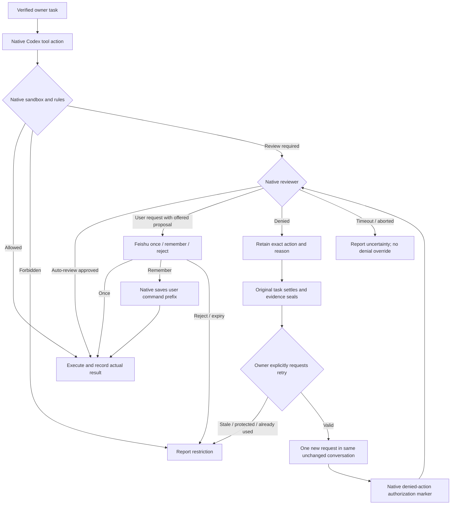

# Owner native permissions

This opt-in handoff feature uses the pinned Codex sandbox, native command rules and Auto-review. It adds no bridge-owned reviewer model in addition to native Auto-review, and no unrestricted execution mode. Source implementation, native protocol evidence, deployment and genuine owner acceptance are separate; see the active [change](../openspec/changes/enable-owner-native-permissions/tasks.md) and [acceptance record](live-acceptance.md).

## Configuration and authority

Add this optional object to the **private handoff configuration**, shared by gateway and assigned Worker. It is not part of either bridge JSON example:

```json
"nativePermissions": {
  "sandbox": "workspace-write",
  "reviewer": "auto_review",
  "rememberCommands": true
}
```

Allowed sandbox values are `read-only` and `workspace-write`; reviewer is `user` or `auto_review`. All three fields are required when enabled; unknown fields are rejected. Omission preserves native defaults. The configured policy applies only to the enrolled tenant/operator/private chat. Native start/resume and every ordinary/repair turn receive on-request approvals and the selected reviewer. Turns explicitly restrict network access inside the sandbox and use Codex's ordinary cwd/tmp workspace semantics; outside-sandbox requests still go through native policy. Model, effort, subscription authentication and unrelated sessions are unchanged. The routing thread remains tool-disabled.

The execution authority is Codex. Bridge access checks select who may request work and respond; the private ledger records provenance rather than replacing native policy. A successful Auto-review usually needs no Feishu prompt. Approved reviews stay quiet. Denied, timed-out and aborted reviews are retained separately from the task outcome: the agent may continue through another authorized approach. Auto-review may consume native model usage; no token-saving claim is established.



This diagram distinguishes conceptual native decisions from the bridge's supported entry points. A new request after refusal still receives native review; explicit user authorization does not guarantee approval. Direct human requests only offer Remember when Codex actually supplies the matching amendment decision.

## Remember and inspect

For a current native command approval, an offered prefix from `gh pr view`, `gh pr list`, `gh run view`, `gh run list` or `gh repo view` may receive **批准并记住规则**. Generic shell/interpreter prefixes, arbitrary GraphQL, network proposals, fresh-human-only commands and stdin requests do not receive this affordance. The card shows the full prefix before selection. `/approve-save <prompt>` is the equivalent fallback only for a confirmed, fully disclosed Remember card; hidden prefixes and oversized text-only previews cannot persist a rule; ordinary `/approve` remains once-only.

The native `acceptWithExecpolicyAmendment` response targets the existing task/thread/turn/generation. Codex saves to current `CODEX_HOME/rules/default.rules`. This is **user-level**, allows parameter variation, may apply across repositories and affects other clients sharing the home. It is not Bot-only or repository-only authorization. Callbacks supply selectors, never rule content. Foreign, stale, expired or unconfirmed cards cannot persist a rule.

Submission, observed native-file persistence and the actual command result are distinct. A green/terminal card does not prove a save. `/rules` is a no-model inspection of recent Bot grants, current file presence, historical save confirmation and the decision returned by the installed native checker for the prefix against current user `.rules` files. It does not claim to evaluate every complete command, project rule or organization restriction. Queries do not update native evidence, grant history or execution state.

`/rules revoke <grant UUID>` adds a `prompt` prefix to `rules/codex-feishu-bridge-revocations.rules`; `/rules allow <grant UUID>` removes only that overlay. An actor-bound submitted grant remains eligible for explicit revocation after a lost save observation; no replay of approval is required. They never rewrite default.rules or unrelated rules. The owned file uses locking, checked contents and atomic replacement. Changed/manual content or uncertain writes stay unconfirmed and do not replay on duplicate ingress. A new explicit owner command is needed after inspection. Prompt means renewed native review, which may itself approve automatically. Already loaded executors can retain policy; this is not instant revocation of running commands.

## Denied actions and explicit retry

Pure private text-rich-post copies of `/rules`, `/reviews` and `/review <UUID>` are accepted as read-only queries. Rule changes and retry commands require text messages or their supported authenticated buttons.

`/reviews` lists recent non-approved native reviews; `/review <UUID>` shows one retained review including the exact working directory. Oversized/UTF-8-heavy records fall back to complete split text with atomic query/publication receipts; no retry is offered for those records. After source settlement, the Bot may send a review card. A concrete, fully visible command/execve denial may offer **授权此动作，发起一次重试**; the typed equivalent is `/review-retry <UUID>`. Cards expire after 15 minutes and require a confirmed platform message, actual enrolled actor and private chat. Timeout, abort and unsupported action types never become denied-action authorization.

The source must have matching immutable sealed journal/checkpoint, native generation/thread/turn and no execution protection. Admission atomically verifies that its conversation has not advanced or acquired conflicting work, creates one fresh ordinary request and consumes that denial's retry identity. Duplicate callbacks, restart and uncertain dispatch cannot create another request. The adapter rechecks source bytes, resumes the same native thread, calls experimental `thread/approveGuardianDeniedAction` with the retained action, then starts the explicitly requested new turn. Native re-review remains enabled. No default rule, original outcome, repair credit or verification report is changed. New-task activity and results are visible via `/tasks` and `/task`.

The native method injects an authorization marker into conversation context; it is not an expiring OS capability or an RPC that executes a command. The bridge bounds **new-request admission** to once per denial, not the model's internal tool-call count or lifetime of retained native context. The retry prompt limits work to that action; subsequent work remains governed by its user request and native policies. Stronger per-tool one-use enforcement would require upstream support or a different execution boundary.

## Storage, upgrades and evidence

The private `permissions/bridge.db` is bound to enrolled identity and canonical CODEX_HOME. Native journals add immutable optional review observations; legacy sealed journals remain readable without migrations. Transport owns confirmed card identity, atomic query/notice receipts and same-card updates. Callback requests use a distinct durable origin while replies/reactions target the actual platform card.

Closed backups and supported rollback archive the permission ledger, retry bindings, review/card receipts and native evidence. **Native rule files are an external policy dependency**: inventory their exact home and contents separately. Runtime rollback does not undo user permission changes, and restoring an old audit DB does not prove current rules were restored. Do not copy Codex authentication. Drain prompts, tasks, feedback and card updates before compatible conversion or downgrade; old runtimes do not implement these controls.

Run `npm run check` and `npm run smoke:codex`. `npm run verify:permissions` additionally exercises the installed native parser, owned prompt overlay and a scripted denied-action RPC without inference or command execution. `npm run verify:permissions -- --native` consumes model usage for one isolated Auto-review-approved file write. Scripted denial/RPC success does not prove an actual denied-then-approved model retry, nor a genuine Feishu owner interaction. Keep those acceptance limits explicit.

Native contracts: [app-server](https://learn.chatgpt.com/docs/app-server.md), [rules](https://learn.chatgpt.com/docs/agent-configuration/rules.md), [Auto-review](https://learn.chatgpt.com/docs/sandboxing/auto-review.md). Experimental interfaces are pinned to [the generated compatibility authority](../src/codex/generated/version.ts); regenerate and verify before upgrading.
