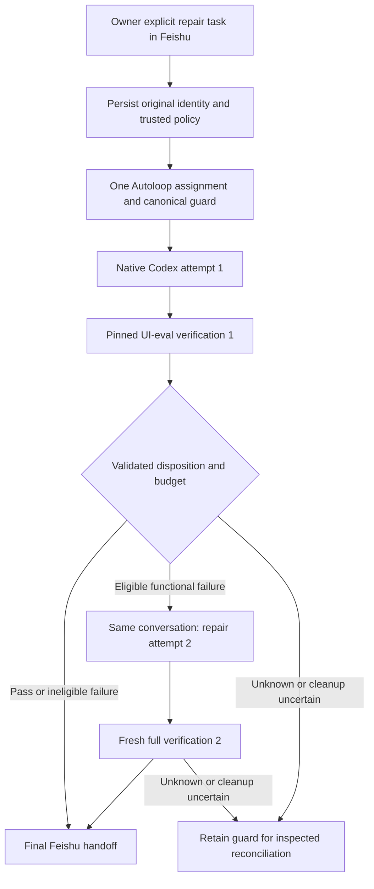

# Bounded verification repair design

Status: proposed only. No runtime or deployment changes are delivered by this document.

## Scenario and composition

An owner explicitly requests a small change with one repair allowed. Codex implements it; UI-eval finds a reproducible functional assertion failure; the same native conversation receives validated evidence and repairs the candidate; the fixed full suite runs again. Feishu receives the final outcome with separate native, verification, review and publication facts. First use an isolated Web fixture with pinned assertions. Proposed `/verify-repair PROFILE TASK` starts a new task, never a replay of historical work or arbitrary imported reports. Existing `/verify` remains one turn plus one verification.

Autoloop owns assignment/admission. A bridge-owned goal coordinator inside that assignment owns this fixed continuation policy and durable transitions. Codex owns reasoning/tools; UI-eval owns execution/evidence semantics. No second queue, model manager or nested UI-eval agent loop is introduced. Report content is reference data, not execution authority.

## Admission and budget

Require the existing enrolled owner/private chat/approval role, explicit new-task opt-in and a trusted repair-enabled profile. Snapshot original tenant/actor/chat/message, project/profile digest, engine/build/policy pins, allowed functional scenario IDs, **one** additional native turn and a finite work deadline. Chat/report text cannot enlarge them.

Trusted policy must supply a positive total duration; this design adds no runtime default. Validate the actual Worker outer timeout covers that duration plus bounded native/verifier shutdown grace. Persist work and cleanup deadlines. Approval waiting consumes the work budget. At that deadline request stop and enter bounded cleanup; no later turn may start. Refuse an insufficient outer budget before dispatch. This limits scheduled work, not exact tokens: native turns differ in reasoning/tool use, and subscription rate limits remain external.

Hold the same canonical guard throughout. Source may change during native work, then must stay stable during each capture and until repair dispatch. Recheck source and trusted pins before dispatch; drift returns to the owner. This guard serializes harness work, not all host writers or same-account filesystem access. Pin mandatory assertion/policy files across both attempts; weakening them cannot produce acceptance. Their trusted dependency list still needs review.

## Narrow repair eligibility

Use deterministic rules over the current task's fresh validated evidence, not prose, exit code 1 or reason-string matching. All conditions are required:

1. Native work completed; task/source/suite/engine/policy binding is valid; owned cleanup is confirmed; no goal stop is accepted.
2. All required engine, prepare, session, check, source and evidence stages passed. No required stage or plan conclusion is missing, interrupted, inconclusive, needs-review or unassessed where required.
3. Every failing scenario is registered for repair. Its canonical report/capture shows valid execution and a directly observed failed **product functional assertion**; other variants pass. Visual/similarity judgments, external-service outcomes and unsupported finding types are excluded.
4. No other gates/dimensions failed and no runner/driver/fixture/external-service fault exists. Use the selected engine's validators and typed evidence rather than copying its heuristics. If that pin cannot establish this narrower predicate, return to the owner.
5. Source/pins still match and repair credit/deadline remain available.

Known build/check failure, human visual review, stale evidence, missing environment or rate limiting therefore returns a truthful failed/incomplete handoff without repair. Missing/invalid results after possible launch or unsettled cleanup retain an unknown guard. Engine-internal infrastructure attempts, where supported, grant no additional Codex turn; this first slice is Web-only.

The continuation carries the original objective/constraints, bounded validated failure references and remaining budget. Reports/source remain untrusted references. Require candidate repair rather than weaker assertions. A pass still needs independent review where applicable; pinned files do not prove the full executable dependency graph is immutable.

## Attempts, controls and evidence

The current owner and verification table represent one native turn and one observation. Do not rerun `/verify`, overwrite that row or mutate sealed journals. Keep existing version-1 interpretation unchanged; introduce a separately discriminated goal record with unique ordered attempt IDs, per-attempt checkpoints and a manifest binding ordered hashes. Unsupported readers must reject the new contract instead of interpreting it as single-turn success. Activate only a compatible gateway/Worker pair.

The outer execution ID remains the goal identity and one owner retains the assignment. Before any native/verifier dispatch, atomically commit its exact intent and consume the credit; only the current authenticated owner advances it. Duplicate events/redelivery/missing acknowledgement cannot create a new credit or second child.

Each native attempt has a separate journal, generation/turn, child settlement and sealed checkpoint. Attempt 2 resumes only the conversation verified by attempt 1's checkpoint and original owner/project binding. Add an explicit internal continuation port carrying the admitted goal authority and evidence references. **Do not fabricate a Feishu owner message, approval or reply target.** Preserve the real original trigger for replies. Prove this port and actual controls in an isolated prototype before production implementation; document a missing API rather than impersonating ingress.

During native work retain actual Codex approvals/questions/steering and permissions, bound to goal/attempt/generation/thread/turn and actor. Stale attempt-1 approval cannot control attempt 2. During verification and transition gaps only status/stop are supported; reject other controls rather than queue them into a future turn. Persist stop at goal scope, prohibiting all later launches even when eligible evidence has just arrived. Uncertain control dispatch remains lookup-only.

Seal prior attempt evidence before advancing. Never rewrite old outcomes, reports or receipts. Live prompts are current-attempt projections. Buffer attempt final answers until goal settlement, then project only the final relevant answer plus goal summary with stable transport IDs; earlier raw answers remain private evidence. Stopped, failed or uncertain outcomes override optimistic native prose in the goal headline.

## Settlement, restart and rollout

Known settlement distinguishes verified declared scope, candidate failure after budget, ineligible/incomplete evidence and stopped. Unknown child/effect/evidence state remains guarded. Native completion, verification, independent review, business acceptance, delivery and publication authority stay separate.

A live authenticated owner can continue through committed transitions despite gateway reconnect. Owner/Worker loss never automatically resumes an unfinished goal, even if a credit appears unused. Startup reconciles intents/checkpoints/child identities/manifest lookup-only. After inspection, a gap without uncertain children can close as incomplete; possible launch or incomplete cleanup retains protection. A fresh owner task is required after settlement/recovery.

First slice keeps goal uncertainty in local inspected maintenance; existing Feishu native-only `/recover` cannot release the new goal type. Drain goals/controls/prompts/delivery before upgrade/rollback and retain all attempt/report assets. Add compatible format/conversion handling before activation; old single-observation converters cannot be reused blindly.

First prove explicit same-conversation continuation and actual current-attempt approval/stop. Then exercise SQLite/child/Hub boundaries with a deterministic fixture fail → repair → pass, already-pass, mixed/ineligible failure, unchanged `/verify`, changed policy/source, second failure, stop races, stale approval, deadlines, duplicates and possible-launch restart windows. Retain both journals and fresh report pairs; history/delivery retries cannot rerun work. Implementation review and isolated evidence precede coordinated activation and concrete owner-private acceptance. Record any real inference separately. Business acceptance and deferred host exercises remain open.

## Expected effect and maintenance

An eligible one-step defect can yield a repaired/reverified candidate from one owner message. An already passing task adds no repair turn; a failing task adds at most one turn and one full verification. These are bounds on attempts, **not a token ceiling or measured efficiency gain**. Retain attempt counts, native/verification durations, stop reason and available native usage metadata without inventing missing usage totals.

The maintenance cost is attempt/control/evidence lifecycle, not another scheduler or model SDK. Keep eligibility narrow and the engine pinned; broader failure classes need separately justified policy/evidence. No business task or disruptive host exercise is required for isolated development.
