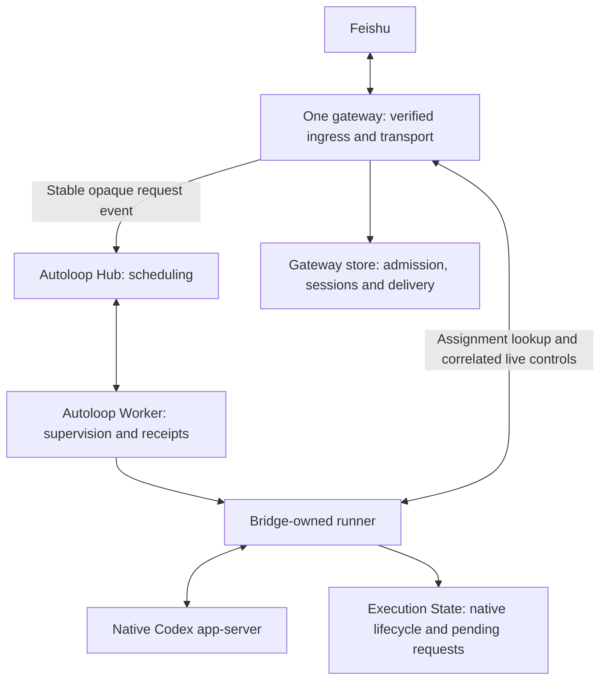

## Context and choice

Use the pinned Autoloop kernel through its source/worker/channel boundaries. Keep native Codex as the reasoning/tool runtime, one Feishu gateway as the human interface, and SQLite for this single-host integration. No additional model coordinator or scheduler is required.

P0's standalone runner is a starting point, not the production gateway. Its per-run replay guard, synthetic actors, control socket and fixed receipts do not supply project-wide admission, reliable real chat delivery or migration.

## Pilot boundary

One host, one bot consumer, one operator chat and one canonical registered project. A designated approval chat may be separate. Natural task text targets that pilot project; no extra classifier inference is needed. Explicit out-of-pilot projects fail admission rather than falling back to an arbitrary directory. Automatic multi-project routing is not silently advertised as supported by the pilot. An existing shared bot cannot be narrowed without an impact inventory and owner-approved activation window; an isolated test must not connect to that bot by default.

Native account, tools, sandbox and approval configuration remain native. Autoloop access metadata grants no additional native permission. Validate the assignment against the registered project and approved policy before `turn/start`; conflicting requirements fail visibly. Publication and business-data authority still come from the original task and project rules.

## Responsibilities and process topology

The runner/app-server stay inside the Worker's owned process group. The gateway does not own a second queue that chooses the next business task. Its inbox and source outbox deliver accepted requests to the Hub. The runner accepts exactly one bound execution at a time; Bridge's current multi-task ingress/drain is not exposed as another dispatch authority. Reuse the supported native interaction and formatting code through explicit execution/transport ports; do not ship a new gateway that also calls the legacy global `kick()` path.

Preserve P0's separate durable execution record so a gateway outage cannot erase native completion. Each execution directory is keyed by the gateway-issued execution ID, not an Autoloop attempt or merely a Hub run number. This survives different attempts/rounds for the same original request. The gateway database owns the project guard and request-to-execution pointer; the execution State owns the native outcome and request dispatch audit. Processes never call legacy `State.recover()` over another live runner's database.

## Identity and durable acceptance

| Record / fact | Authority and use |
| --- | --- |
| Verified message identity | Feishu normalization/admission: bot installation, tenant, sender, chat and immutable message ID; quoting/mention text does not supply identity |
| Request ID | Gateway-generated opaque ID, unique for the verified source message; stable across source POST retries |
| Conversation ID | Gateway owner/chat/project/session mapping captured at acceptance; native thread resolved at dispatch, after earlier work has settled |
| Project ID | Registry entry for the canonical real directory; aliases and symlinks cannot produce separate resource identities |
| Execution ID | Persisted before native effects; bound to request, conversation, project and policy; reused when the same request appears in another scheduler attempt/round |
| Hub instance, source event and run IDs | Scheduling correlation; cannot grant execution authority or replace an existing execution identity |
| Native thread/turn and process generation | Execution State / native app-server; required for controls and live responses |
| Reply UUID and destination | Gateway transport outbox; retries preserve identity and never rerun work |

Persist source deduplication, immutable request payload, admission outcome and source submission intent in one local transaction before acknowledging acceptance. Received reactions mean receipt, not native completion. Unauthorized traffic remains silent as today. A malformed or out-of-scope request receives the existing bounded help/clarification behavior without becoming a kernel event.

Publish only opaque request ID, registered event type and bounded non-sensitive summary to Autoloop. The authoritative prompt, actor and project lookup stay in gateway-owned records; copied text in job context cannot change them. The adapter verifies installation, source, rule, agent, project/cwd and exact request count against that registry. Unknown timers, manual runs, replay events or card answers do not authorize an original task.

A source POST timeout is uncertain delivery, not a new request. Retry the identical event ID/payload, then inspect the source event outcome through the pinned public API. Confirm an actual expected route: an unrouted or paused/skipped event is not successfully scheduled work. Preserve the request and expose the blockage; do not mint another ID to bypass deduplication. Native effects require both a valid assignment and admission by the execution boundary.

## Routing without coalescing or shared sessions

The inspected kernel coalesces queued events in the same rule/lane. With `resume: true`, it can inherit a completed session within that scheduling lane. Neither behavior is an acceptable substitute for chat ownership.

For P1:

- Use the immutable request ID as event subject and enable subject lanes with `parallel: 1`. In the pinned kernel, a positive value selects subject lanes; the value one also limits that group to one claimed run. Distinct lanes therefore do not require concurrent project execution.
- Use one canonical-project group shared by every alias/rule for that real directory, with consistent `parallel: 1`. A single native-agent definition can serve different project groups; no per-project agent fleet or duplicate concurrency limit is needed. Worker capacity is also one for the pilot. Configuration validation must reject aliases that split the same real directory across groups.
- Set `resume: false`. The runner ignores scheduler session suggestions as execution authority and resolves the native conversation from the verified conversation ID. The reported native session remains useful as a status projection.
- Require exactly one recognized request event per initial assignment. A duplicate publication uses the same event ID. Unexpected mixed events fail closed; never merge prompts or pick one silently.

This separates the scheduling lane (one request), native conversation (owner/chat/project/session) and resource (canonical project). The feasibility command tests kernel behavior; it does not implement gateway validation or native session lookup. Keep the selected values/shape in [the routing fixture](../../../experiments/autoloop/verify-handoff-routing.mjs) and verify them before upgrading [the shared pin](../../../experiments/autoloop/source.json).

## Admission, outcomes and uncertainty

Before any native start/resume with tool-capable work, atomically bind the execution and acquire the canonical project guard. A duplicate assignment returns the retained outcome or attaches to the proven live owner; it never calls `turn/start` again. Missing/unreachable owner, lost start response, incomplete journal or ambiguous cancellation retains the guard as uncertain. A Worker lease expiry, Hub `done`/`cancelled`, gateway reboot or elapsed timeout cannot release it.

New requests for a guarded project are recorded as blocked/refused admission, with a specific explanation. Already published requests must recheck the guard at execution admission and remain blocked without native invocation. Hub rules must not be paused as a substitute for this guard: paused source events can be recorded as skipped. A reply to an Autoloop business card does not clear the guard or approve a native RPC.

Reconciliation records who inspected what evidence and the resulting decision. Confirm native/process settlement and actual project/external effects, then distinguish: retained completion; known not-started work; explicitly authorized remaining work; or unresolved uncertainty. A controlled continuation gets its own identity and authority for remaining steps. It is not a replay of the original operation. Without evidence, keep the guard held.

Persist native terminal outcome/final answer before producing the normalized scheduler receipt. Retain native round status, business acceptance and reply delivery as separate fields. Raw model output cannot schedule events by accidental receipt syntax. P1 retains a deterministic receipt adapter and uses the gateway's original-owner reply; model-authored follow-up events and evidence-based objective completion are P3/P4 contracts.

## Live controls and human responses

Resolve status, steering and stop from the verified owner/chat and immutable quoted-task association or unique owned active execution. Admin approval authority alone does not confer ownership to steer or stop another task. Keep project/session switching from retargeting an in-flight control.

Persist each accepted control under its Feishu message identity before relaying through private authenticated IPC. Bind the relay to execution ID and current native generation/thread/turn, plus pending request ID for native responses. The runner revalidates these facts at the point of dispatch, including after awaits. A repeated message returns the recorded relay result. For a dispatch with an uncertain acknowledgement, inspect recorded dispatch/native state before any retry; never report a supplement as accepted merely because the IPC write succeeded.

Execution State is canonical for native dispatch, pending prompts and completion. Gateway control state is canonical for receipt/relay/delivery only; its projections cannot independently decide that a native request remains pending. Never resend an approval because its chat delivery or IPC acknowledgement was lost. Timeout/stop/generation change invalidates native responses without granting approval. Preserve designated administrator/chat checks and original-owner question checks from the existing Bridge.

Stop remains pending until native terminal/process evidence confirms settlement, or explicitly becomes unknown with the guard held. Cancel the Hub run when required to remove queued dispatch, but do not equate that scheduling status with native settlement. `/clear` affects only the requesting session's not-started work; `/new` cannot bypass outstanding work or project guards.

A gateway restart reconciles retained execution references and live runners before admitting new work. Runner IPC loss may delay control and delivery while native work continues; it is not proof of termination. The runner persists completion locally even when the gateway is unavailable. Reconcile and project native evidence into the gateway outbox idempotently when connectivity returns.

## Delivery and retained state

Preserve original trigger/reply destination, verified mention allowlists, final-answer filtering, secret redaction, ordered rich-post splitting, stable UUIDs and durable reaction cleanup. Reuse these existing contracts rather than changing chat UX as part of scheduler migration. Native prompt delivery remains distinct from business-card delivery. Delayed prompts are revalidated against the live owner; gateway restart cannot resurrect an expired approval.

The two stores intentionally hold different facts. Execution State is canonical for lifecycle evidence; the gateway contains an execution reference/projection plus transport state. Native history remains canonical for conversation content. Project-guard release and outbox creation must reference the exact retained execution version; a stale projection cannot overwrite a later result or clear uncertainty. This is not a second scheduling ledger.

## Drain-first cutover and rollback

Activation is a separate owner-authorized operation. Prepare a manifest first: bot/tenant/host identity, affected audience, project real path, approval destination, protocol-compatible old/new artifacts, state locations, service owners, pin and acceptance evidence. Do not store its private values in this repository.

1. Rehearse export/import and rollback on fixture copies. Reject invalid ownership, missing conversation/quote references and native version mismatch. Do not copy native authentication or downgrade another daily-use client for rollback.
2. Add a quiesce capability to the legacy-compatible entry point: stop admitting new business tasks while retaining controls, approvals, final delivery and reaction cleanup. This capability is not implemented by the current `npm start`.
3. Drain queued/running work and delivery/cleanup. Require no live approvals, unknown effects or unresolved guards. If drainage cannot complete, postpone; P1 does not transfer active/queued write-capable work.
4. Prevent the old service's automatic restart, stop it and confirm its consumer/native child settled. Acquire its released state ownership lock before snapshot/import and retain exclusive managed ownership through new startup; startup/lock transfer must be covered by the handoff tool, not two competing launch commands. Inventory any other authorized consumers; a local lock does not prove another host is absent. Start no second SDK listener during preparation.
5. With SQLite closed, snapshot and checksum state. Import completed owner/session/native-thread mappings, immutable source deduplication and reply/task associations using a versioned exporter. Keep the snapshot immutable; verify semantic counts and relationships, not just file hashes.
6. Start the new runtime against its prepared state, initially closed to new work. Reconcile execution references/guards and verify the exact manifest, policy and protocol before connecting the sole consumer. Perform only the authorized owner-chat acceptance; then open admission for the approved scope.

Before the new runtime accepts anything, rollback can restore the verified closed snapshot and compatible old artifact after the new consumer stops. After any new request/control/delivery is accepted, restoring only the old snapshot is unsafe: it loses deduplication, outcomes, reply identities and new native conversation facts. Quiesce/drain the new runtime, export its post-cutover records, reconcile them and import them with a tested reverse converter. If that converter or settlement evidence is unavailable, remain paused with records intact; do not restart the old scheduler and replay missing work. Unknown effects block rollback admission just as they block forward admission.

No dual-write queue or shadow model execution is used. Rollback does not undo external operations and never authorizes production publication.

The consumer transition has an unavailable interval. Do not assume Feishu replays messages that arrive while disconnected. Acceptance guarantees apply to durably admitted requests, not every message sent during that interval; report the maintenance window and reconcile owner expectations before reopening.

## Delivery slices and outstanding choices

First prove the kernel configuration. Then implement durable gateway admission/project guards, the single-assignment runner boundary and correlated control/result delivery against synthetic transport. Add migration/quiesce tooling and fixture rehearsals before touching deployment. Finish pending P0 native interaction/recovery acceptance, then request activation against the concrete prepared manifest when the pilot is ready.

The pilot's actual bot/chat/project and rollout window are deployment inputs, not assumptions for source development. No current implementation is blocked on those private values. Model-based multi-project routing, business follow-up scheduling and broader concurrency remain outside this pilot; do not invent compatibility switches for them now.
